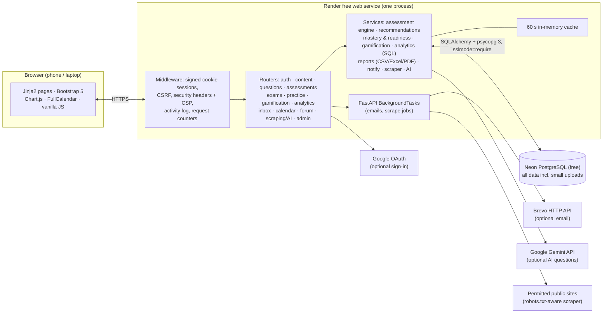

# Smart Prep: Web-Based LET Preparation Platform with Analytics

MIT capstone project for LET (Licensure Examination for Teachers, Philippines) reviewees of
**Romblon State University – Cajidiocan Campus**. Smart Prep combines an LET question repository, mock exams,
adaptive practice, gamification and learning analytics. It runs **100% free** on one Render free web service with a
Neon free PostgreSQL database.

**Stack:** Python 3.12 · FastAPI · Uvicorn · Jinja2 · Bootstrap 5 · vanilla JS · Chart.js · FullCalendar ·
SQLAlchemy 2 · Alembic · psycopg 3 · PostgreSQL (Neon) / SQLite (local) · pytest

**Roles:** Student (self-registration with email verification) · Faculty (TOTP 2FA) · Admin (TOTP 2FA)

| Docs | |
|---|---|
| [User Manual](docs/User_Manual.md) | How students, faculty and admins use every module |
| [UAT Checklist](docs/UAT_Checklist.md) | Acceptance tests: Login, Profile, Adaptive Learning, Recommendations, Gamification, Question Repository, Exam Preparation, Content Search |
| [FAQ](docs/FAQ.md) | Common questions, including free-tier behavior |

## Build status

| Phase | Scope | Status |
|---|---|---|
| 1 | Foundation: models, migrations, auth (register/verify/login/reset/2FA/Google), roles, layout, admin users | ✅ |
| 2 | Content: categories/courses/topics, question bank, review queue, import, resources | ✅ |
| 3 | Assessments: exams/quizzes, timer, results, grades | ✅ |
| 4 | Recommendations, adaptive practice, study plan, gamification | ✅ |
| 5 | Analytics & reports | ✅ |
| 6 | Notifications, inbox, calendar, goals, forum | ✅ |
| 7 | Web scraping & optional Gemini generation | ✅ |
| 8 | Hardening, demo data, backups, docs | ✅ |

## Architecture



Design choices that keep it free and simple:
- **One web process.** Background work uses FastAPI `BackgroundTasks`; deadline reminders and timer expiry are
  checked lazily on page loads (no cron, no workers).
- **No local disk.** Uploads (max 5 MB) are stored in PostgreSQL; backups are generated in memory.
- **Optional integrations hide themselves** when their environment variables are missing; the app needs only
  `DATABASE_URL` and `SECRET_KEY`.
- **`/healthz`** answers without touching the database, and migrations run only in the build command, so cold starts
  are fast.

## Local setup (Windows 11)

Requires Python 3.12+ (Render uses 3.12) and Git.

```powershell
git clone https://github.com/fcarabuena/SmartPrep-Web-Based-LET-Preparation-Platform-with-Analytics.git
cd SmartPrep-Web-Based-LET-Preparation-Platform-with-Analytics
py -3.12 -m venv .venv
.venv\Scripts\activate
pip install -r requirements.txt
copy .env.example .env          # optional; defaults use local SQLite (smartprep.db)
alembic upgrade head
python scripts\seed.py          # categories/courses/topics, 100 sample questions, resources, badges
python scripts\create_admin.py --email admin@example.com --name "Site Admin"
uvicorn app.main:app --reload
```

Open http://127.0.0.1:8000. Admin and faculty accounts set up an authenticator app (Google Authenticator,
Microsoft Authenticator, Authy…) on their first sign-in.

**Demo data** (1 admin, 3 faculty, 60 students, 317 original questions, ~1,700 attempts over 8 weeks, badges,
messages, forum posts, goals):

```powershell
python scripts\seed_demo.py              # adds demo data
python scripts\seed_demo.py --wipe       # DELETES ALL DATA first (asks for confirmation; add --yes to skip)
```

Demo sign-ins: `admin@smartprep.demo` / `Admin12345`, `faculty1@smartprep.demo` / `Faculty123`,
`student01@smartprep.demo` … `student60@smartprep.demo` / `Student123`. Change them before real use.

If PowerShell blocks `activate`, run `Set-ExecutionPolicy -Scope CurrentUser RemoteSigned` once, or call tools
directly: `.venv\Scripts\python -m uvicorn app.main:app --reload`.

### Tests

```powershell
.venv\Scripts\python -m pytest
```

The suite uses an in-memory SQLite database, HTML fixtures and mocked HTTP/AI clients — no network access.
It includes a permission matrix that checks **every route for every role** (and fails if a route has no
`require_role`), CSP/inline-script checks, a migration-vs-models check, query budgets for busy pages and an
end-to-end run of `seed_demo.py`.

## Free deployment (Render + Neon)

1. **Neon** (https://neon.tech, free plan): create a project (choose a region near Render's, e.g. AWS Asia
   Pacific – Singapore) and copy the **connection string** (`postgresql://…neon.tech/neondb?sslmode=require`).
2. **Render** (https://render.com): **New › Blueprint**, choose this GitHub repository. Render reads
   [`render.yaml`](render.yaml) and creates one **Free** web service:
   - build: `pip install -r requirements.txt && alembic upgrade head`
   - start: `uvicorn app.main:app --host 0.0.0.0 --port $PORT --proxy-headers --forwarded-allow-ips='*'`
   - health check `/healthz`; `PYTHON_VERSION=3.12.7`, `ENV=production`, `SECRET_KEY` generated automatically.
3. When prompted, paste the Neon string into **DATABASE_URL** (optional keys may stay empty) and apply.
4. After the first deploy, set **BASE_URL** to your `https://<name>.onrender.com` address (used in email links).
5. From your laptop, point at Neon and create the admin (and demo data if you want it):

```powershell
$env:DATABASE_URL = "postgresql://...neon.tech/neondb?sslmode=require"
.venv\Scripts\python scripts\create_admin.py --email you@example.com --name "Your Name"
.venv\Scripts\python scripts\seed_demo.py     # or scripts\seed.py for content only
Remove-Item Env:DATABASE_URL
```

Optional: add `BREVO_API_KEY` + `MAIL_FROM` (a verified Brevo sender) for email, `GOOGLE_CLIENT_ID` /
`GOOGLE_CLIENT_SECRET` for Google sign-in (redirect URI `https://<your-app>/auth/google/callback`), and
`GEMINI_API_KEY` for AI question generation.

### Free-tier limits to know

| Service | Limit | Effect on Smart Prep |
|---|---|---|
| Render free web service | Sleeps after 15 min idle; ~1 min to wake | First visit after idle is slow; exam timers are server-side and unaffected |
| | 750 free instance hours/month | Enough for one service running all month |
| | No persistent disk | Uploads live in PostgreSQL (max 5 MB each); backups are generated on demand |
| | Outbound SMTP blocked | Email goes through Brevo's HTTPS API |
| Neon free | 1 GB storage per project | Keep uploads small; check **System Health** for the DB size |
| | 100 compute-hours/month, scales to zero | Light use fits easily; the first query after idle can take a moment |
| | No expiry | Data stays as long as the project exists |

## Features by module

### Content
- **Categories › Courses › Topics** (`/content/categories`): General Education, Professional Education and
  Specialization (Major Core). Major courses are only visible to students of that major.
- **Question bank** (`/questions`): search, filters (category, topic, difficulty, status, source), bulk actions,
  live duplicate detection (normalized stem hash + similar-stem search). Students only ever see **approved** items.
- **Review queue** (`/questions/review`): approve/reject pending items (scraped, AI-generated and imported).
- **CSV/Excel import** (`/questions/import`): downloadable templates, preview with row-level errors, duplicate
  skipping, server-side re-validation on confirm.
- **Resources** (`/resources`): links, videos, articles and small uploads (PDF/DOCX/PPTX/images, max 5 MB, type and
  content checked) stored in the database. Students browse and search them at `/materials`; every open is tracked.
- **Seed content**: 100 original LET-style questions (10 per sample topic, each with a rationalization).

### Assessments
- **Types:** practice quiz, mock exam (LET simulation), timed quiz game, quiz bee. Scope by category, course and/or
  topics; auto-draw by difficulty or manual pick; randomized questions and choices; time limit; access code;
  open/due dates; max attempts; points per correct answer and pass bonus (`/assessments`).
- **Examinations** page with Prof Ed / Major Core / Gen Ed tabs, instructions, time limit, due date and "Past Due";
  **Quizzes** page grouped by category and course.
- **Taking:** one question at a time, question navigator, autosave every 15 s and on every answer, per-question time
  tracking. The timer is enforced on the server (`deadline_at`); late saves and page loads auto-submit expired attempts
  (no cron needed).
- **Pass thresholds:** 75% (attempt 1), 80% (attempt 2), 85% (attempt 3+), configurable in `/admin/settings`; the
  threshold used is stored on each attempt.
- **Results:** score, pass/fail, chosen vs correct answer with rationalization for every item, Retake.
- **Grades** (`/grades`): Passed / Failed / Missing / Not attempted with category/course filters, print stylesheet
  and PDF export. Faculty see every attempt under `/submissions`.

### Adaptive learning & gamification
- **Recommendations** (results page): resources per topic proportional to wrong answers (1 wrong → 1, 3 wrong → 3,
  capped in settings), topic practice first, then videos/articles; level by mastery (<75% foundational, 75–84%
  standard, ≥85% advanced and fewer items).
- **Regenerate Questions:** adaptive set for the same scope; topic weight = 1 − mastery, difficulty mix by mastery,
  avoids questions seen in the last 7 days. Adaptive sets never use up graded attempts.
- **Study Plan** (`/study-plan`): weakest topics first with mastery bars, leveled resources and "Start practice".
- **Points ledger** (correct answers, completion, pass + bonus, perfect score, improvement, quiz series, recommended
  resource views with a daily cap, daily streak) and **levels** (level n starts at step·n(n−1)/2 points).
- **Badges** are data-driven rules (accuracy, improvement, category mastery, perfect, streak, first quiz, points,
  quizzes completed, manual). Defaults: Accuracy Ace, Persistence Pro, Master of Categories, Perfect Score, Streak 7,
  First Steps. Staff add badges and award manual ones at `/badges`; students get a notification.
- **Leaderboards** (`/leaderboards`): overall (points), by category, by course and by game/assessment. Ties go to
  first-attempt passers, then less time. Faculty can hide leaderboards from students.
- **Games:** faculty-created timed quiz games and quiz bees, plus an instant "Quick Quiz Bee" (15 random questions
  across all subjects, 5 minutes).

### Analytics
- **LET Readiness Score** = weighted category mastery. Secondary: Gen Ed 20%, Prof Ed 40%, Specialization 40%;
  Elementary: Gen Ed 40%, Prof Ed 60% (configurable). Bands: Not ready / Developing (≥60) / Ready (≥75).
- **Student Progress** (`/progress`): mastery by category, rank, badges, questions answered, time spent, quiz and
  exam completion donuts, **Study Hot Zones** heatmap (courses × topics or Exam 1/2/3; green ≥85, yellow 75–84,
  red <75, values always printed), progress by category (Exam 1/2/3 + improvement) and by course (correct %,
  incorrect %, improvement, minutes), attempted vs correct, 8-week trend, strengths/weaknesses, recommendations.
- **Faculty:** class KPIs (average score, pass rate, participation), category performance, weekly trend,
  most-missed topics, **at-risk students** (low readiness or inactive N days), per-student drill-down with
  "Send feedback", **item analysis** (difficulty index p, discrimination index D from upper/lower 27% on first
  attempts, distractor counts, retain/revise/reject flags).
- **Admin:** DAU/WAU/MAU, logins/registrations/submissions per day, peak-activity heatmap (weekday × hour, PH time),
  average session length, popular content, content access by type, questions by source with approval rate,
  **system health** (uptime, request counts, recent errors, DB size, table sizes).
- **Report builder** (`/reports`): user activity, performance, content usage, engagement; date range + filters;
  preview; export CSV / Excel / PDF.
- Aggregations run as grouped SQL (dialect-aware for PostgreSQL and SQLite); heavy views are cached for 60 s.

### Communication & planning
- **Notifications** (bell + `/notifications`): new approved questions/resources, assessment published, due within
  24 h, faculty feedback, badges, goals reached, forum replies, announcements. Deduplicated per event.
  Deadline reminders are checked lazily on page load (at most every 10 minutes per session) — no cron job.
- **Announcements** (`/announcements`): target roles, students who can see a course, or specific students; optional
  email through Brevo.
- **Inbox** (`/inbox`): direct messages between students, faculty and admins with threads, Inbox / Sent / Unread /
  Drafts, course filter and search. Faculty feedback lands here.
- **Calendar** (`/calendar`, FullCalendar): month / week / agenda views with a Today button; assessment due dates,
  goal deadlines, personal events and class-wide events (staff).
- **Goals** (`/goals`): targets for questions answered, quizzes passed, average score, points, readiness or category
  mastery with automatic progress; shown on the dashboard and calendar.
- **Forum** (`/forum`): threads per category/course, replies, search; faculty pin, lock and delete.

### Content input: scraping & AI
- **Web scraping** (`/scrape`, faculty): one job = up to 20 URLs + a target topic, parsed with the
  **numbered MCQ text** parser (`1. … A. … D. … Answer: B … Explanation: …`) or **CSS selectors**. The bot sends a
  custom User-Agent, obeys `robots.txt`, waits 1 s between requests to a host, times out after 10 s, skips
  non-HTML and pages over 2 MB, and refuses private/loopback addresses (SSRF protection). Runs in the web process via
  `BackgroundTasks`; the page auto-refreshes. Extracted questions and captured resource links are shown in an
  editable preview and saved as **pending review** (links are saved hidden). Faculty must confirm the source permits
  scraping.
- **Gemini (optional)** (`/ai/generate`, needs `GEMINI_API_KEY`): generate up to 20 original questions with
  rationalizations for a topic and difficulty, or "Improve wording with AI" on any question. The model must return
  strict JSON; each item is validated (and a suggestion that changes the key is discarded). Everything is saved as
  **pending review**. The menu item and routes disappear when no key is set.
- Tests use HTML fixtures (`tests/fixtures`), a mocked HTTP transport and a fake Gemini client — no live network.

## Configuration

| Variable | Required | Purpose |
|---|---|---|
| `SECRET_KEY` | yes (prod) | Signs session cookies and tokens |
| `DATABASE_URL` | yes (prod) | Neon connection string. `postgres://` is normalized to psycopg 3 with `sslmode=require`. Empty → local SQLite |
| `ENV` | no | `production` enables secure cookies, HSTS and hides API docs |
| `BASE_URL` | no | Public URL for email links (falls back to the request URL) |
| `BREVO_API_KEY`, `MAIL_FROM`, `MAIL_FROM_NAME` | no | Email via Brevo HTTP API. Without a key, emails are printed to the console and new accounts are auto-verified |
| `GOOGLE_CLIENT_ID`, `GOOGLE_CLIENT_SECRET` | no | "Continue with Google" button (hidden when unset) |
| `GEMINI_API_KEY`, `GEMINI_MODEL` | no | AI question generation (hidden when unset) |

## Project layout

```
app/
  main.py            FastAPI app, middleware, error handlers, /healthz
  config.py          settings (pydantic-settings) + DATABASE_URL normalization
  db.py              engine/session (Postgres or SQLite)
  deps.py            current user, require_role, CSRF
  sessions.py        signed-cookie sessions ("keep me signed in")
  security.py        argon2 hashing, one-time tokens, TOTP, CSRF tokens
  middleware.py      security headers/CSP, request counters, page-view logging
  routing_util.py    walks all routes (sidebar visibility, permission tests)
  templating.py      Jinja2 setup, filters, render(), lazy deadline reminders
  models/            SQLAlchemy models (users, content, assessments, gamification, comms, system)
  routers/           auth, dashboard, profile, admin_users, admin_settings, content, questions, resources,
                     assessments_admin, exams, practice, gamification, analytics, notifications, inbox,
                     planning (calendar/goals), forum, scrape_ai, backups
  services/          assessments, recommendations, mastery, gamification, analytics, reports, pdf, notify,
                     goals, content, importer, scraper, ai, email, settings_store, cache, ratelimit, sqlutil,
                     curriculum, seed_content, seed_data/ (original questions + generators)
  templates/         Jinja2 templates (Bootstrap 5)
  static/            CSS, JS (app, take, charts, calendar, questions), logo
alembic/             migrations (0001_initial_schema)
scripts/             create_admin.py, seed.py, seed_demo.py
tests/               pytest suite + HTML fixtures
docs/                User_Manual.md, UAT_Checklist.md, FAQ.md
render.yaml          Render Blueprint (one free web service)
```

## Security

- Passwords hashed with **Argon2**; login rate limit (10 attempts per 5 minutes per IP) and account lockout
  (5 failures → 15 minutes); one-time, hashed, expiring tokens for email verification (48 h) and password reset (1 h).
- **TOTP 2FA mandatory** for admin and faculty (optional for students); sessions are invalidated on password change,
  role change or deactivation.
- Every route enforces `require_role` (verified by an automated permission matrix for all roles).
- **CSRF** token on every POST (form field or `X-CSRF-Token` header for autosave/fetch).
- **Security headers:** Content-Security-Policy (scripts only from `self` and `cdn.jsdelivr.net`, no inline scripts),
  `X-Frame-Options: DENY`, `nosniff`, `Referrer-Policy`, `Permissions-Policy`, HSTS in production,
  `Cache-Control: no-store` on pages.
- Signed session cookies: `HttpOnly`, `SameSite=Lax`, `Secure` in production; "Keep me signed in" = 30 days,
  otherwise a browser-session cookie with an 8-hour idle timeout.
- Uploads: allow-listed types (PDF, DOCX, PPTX, images), 5 MB cap, content sniffing, served with a sandboxing CSP.
- Scraper: robots.txt, 1 request/second, 10 s timeout, 20-page and 2 MB caps, private/loopback addresses refused
  (SSRF protection).
- Secrets never appear in logs or backups (backups exclude password hashes, TOTP secrets and Google IDs);
  `.env` is git-ignored.
- Custom 403/404/500 pages; unhandled errors are recorded in `error_log` and shown on **System Health**.
